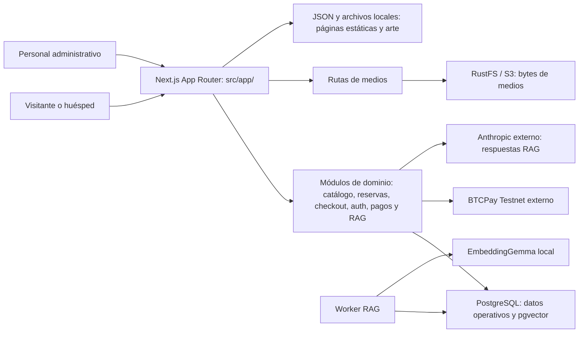

# Gateways El Salvador — CUBO+ Build Sprint 2026

Nueva plataforma de reservas directas desarrollada como MVP, conservando la identidad visual de Getaways El Salvador.

Incluye catálogo, fichas de propiedades, reservas, cotización, checkout, administración, tracking de referidos y analítica básica.

- [Informe estratégico](strategy/Gateways_Informe_Estrategico.pdf)
- [Estado y documentación estratégica](strategy/README.md)
- [Instalación y documentación técnica](src/README.md)
- [Arquitectura ampliada y flujos](src/docs/arquitectura/README.md)
- [Flujos de aplicación](src/docs/arquitectura/flujos.md)
- [Datos y operación](src/docs/arquitectura/datos-y-operacion.md)

## Arquitectura a alto nivel

La aplicación es un sitio **Next.js con App Router**: `src/app/` expone páginas,
layouts y rutas API, mientras que `src/modules/` aplica las reglas del negocio.
**PostgreSQL** es la fuente operativa; **RustFS mediante S3** guarda los bytes de
medios y los archivos/JSON locales se reservan para páginas estáticas y arte.
Las capas, módulos y límites están descritos en el
[mapa de arquitectura](src/docs/arquitectura/README.md).

En checkout, la cotización conserva el **total real de la estancia** separado del
cargo fijo de prueba de **USD 1.00 en BTCPay Testnet**; el cargo de prueba no
sustituye la estancia. BTCPay es externo a los Compose y se habilita solo con la
configuración explícita del proveedor. El detalle de los recorridos está en
[flujos.md](src/docs/arquitectura/flujos.md), y las topologías y fuentes de verdad
en [datos-y-operacion.md](src/docs/arquitectura/datos-y-operacion.md).

# Integrantes del equipo

| Nombre | Rol | Usuario de Discord | Usuario de GitHub |
| --- | --- | --- | --- |
| Roger Rogel | business | roger_40647 | [roger-rep](https://github.com/roger-rep) |
| Luis Bonilla | business | luisma | [luisbodev](https://github.com/luisbodev) |
| Mauricio Martinez | dev | MauricioDMO | [MauricioDMO](https://github.com/MauricioDMO) |

## CUBO+ — The Build Sprint 2026

Caso de estudio: **Gateways El Salvador — Website Optimization, AI & Direct Booking & Marketing**.

- [Estrategia y análisis del caso](strategy/README.md)
- [Checklist de cumplimiento y calendario](strategy/checklist/README.md)
- [Entregables y evidencias](strategy/checklist/entregables.md)
- [Registro diario de trabajo](strategy/checklist/diario.md)
- [Proyecto técnico](src/README.md)
