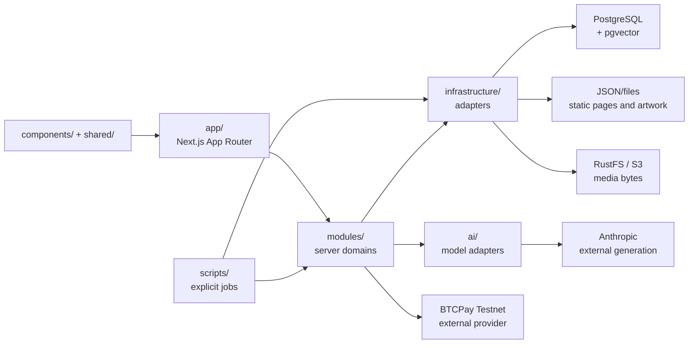

# Arquitectura y mapa del proyecto

[README técnico de la aplicación](../../README.md) ·
[README global](../../../README.md) ·
[Flujos implementados](./flujos.md#flujos-de-aplicación) ·
[Datos y operación](./datos-y-operacion.md#datos-y-operación) ·
[Producción](../produccion.md)

Este índice describe límites observables en el código actual de `src/`. La
aplicación es Next.js con App Router: las rutas reciben solicitudes y componen
la interfaz; los módulos aplican reglas de dominio; la infraestructura conecta
con almacenes y proveedores. Esta página no sustituye al contrato Prisma ni
afirma que un Compose esté desplegado.

## Mapa de lectura

1. Empieza por el [README de la aplicación](../../README.md) para requisitos,
   instalación y comandos de entrada.
2. Usa este índice para localizar capas, módulos, entradas y límites.
3. Lee [flujos.md](./flujos.md#flujos-de-aplicación) para los recorridos
   detallados de sesiones, contenido, reservas, pagos y RAG, incluidos sus
   diagramas sequence/state.
4. Lee [datos-y-operacion.md](./datos-y-operacion.md#datos-y-operación) para
   fuentes de verdad, relaciones, topologías y operaciones con guardas.
5. El [README global](../../../README.md) resume el producto, equipo y
   estrategia; no reemplaza estos contratos técnicos.

Los workflows y sus secuencias viven únicamente en `flujos.md`; las relaciones
ER, topologías y procedimientos viven únicamente en `datos-y-operacion.md`. Este
índice mantiene solo un flowchart de capas complementario y un mapa de código.

## Capas

### `app/`: entrada HTTP y composición

[`app/`](../../app/) es la capa de Next.js App Router. Contiene páginas, layouts,
metadata y route handlers bajo [`app/api/`](../../app/api/). El layout raíz
define documento, fuentes y metadata; el layout administrativo compone el marco
del panel y declara esas páginas no indexables. La salida standalone y las
cabeceras configuradas están en [`next.config.ts`](../../next.config.ts).

Las rutas serializan solicitudes y respuestas, pero no son la autoridad del
estado operativo: llaman a módulos server-only que validan autenticación,
autorización, entrada y persistencia.

### `components/` y `shared/`: presentación y utilidades

- [`components/atoms/`](../../components/atoms/),
  [`components/molecules/`](../../components/molecules/) y
  [`components/organisms/`](../../components/organisms/) contienen las piezas UI
  reutilizables, formularios, navegación, checkout y panel administrativo.
- [`components/templates/`](../../components/templates/) compone vistas de home,
  listing, editorial, checkout y confirmación.
- [`shared/`](../../shared/) reúne utilidades de UI, media, SEO, analítica,
  seguridad y tiempo. Las utilidades server-only mantienen esa dependencia fuera
  de componentes cliente.

Un componente cliente presenta datos y envía entradas; no decide precios,
disponibilidad, identidad ni transiciones persistidas.

### `modules/`: dominios y reglas de negocio

[`modules/`](../../modules/) agrupa el comportamiento por dominio. Sus carpetas
`server/`, `client/` y archivos compartidos expresan la dirección de ejecución.
Los módulos server-only consultan PostgreSQL o adaptadores mediante
`infrastructure/`; los componentes cliente solo presentan y envían datos al
servidor.

### `infrastructure/`: persistencia y adaptadores

[`infrastructure/`](../../infrastructure/) contiene el contrato Prisma 8,
migraciones, cliente PostgreSQL, pgvector, cliente S3/RustFS, lector JSON local
y optimización de imágenes. Es la frontera con base de datos, objetos, archivos
estáticos y extensiones SQL; las vistas no deben resolver esos recursos
directamente.

### `ai/` y `scripts/`: modelos y procesos explícitos

[`ai/`](../../ai/) mantiene los adaptadores de embeddings y Anthropic para RAG;
Anthropic redacta respuestas, pero no es autoridad de precios,
disponibilidad, reservas ni pagos. [`scripts/`](../../scripts/) contiene
importaciones, provisión administrativa, mantenimiento de imágenes, indexación,
worker RAG y comprobaciones BTCPay. Un modo dry-run no equivale a una operación
aplicada.

## Componentes y límites del sistema

El siguiente mapa complementa el resumen global: muestra dirección de capas y
adaptadores, no repite los recorridos de reserva, pagos o RAG.

PostgreSQL es la fuente operativa de contenido publicado, catálogo y taxonomía,
cuentas, reservas, intentos de pago, referidos y el índice/cola RAG. RustFS/S3
guarda bytes y PostgreSQL guarda la metadata `MediaAsset`; el lector JSON local
queda para páginas, copy y arte estático. Las relaciones completas y excepciones
de propiedad están en [fuentes de verdad](./datos-y-operacion.md#fuentes-de-verdad-y-límites).

## Límites y guardas

- **Privacidad y robots:** `next.config.ts` aplica `private, no-store`,
  `Pragma: no-cache`, `Referrer-Policy: no-referrer` y `X-Robots-Tag` solo a
  `/checkout`, `/booking-confirmation`, `/api/bookings`,
  `/api/checkout/:path*`, `/account/:path*`, `/api/guest/:path*`, `/admin`,
  `/admin/bookings/:path*`, `/api/admin/bookings/:path*`,
  `/admin/listings/:path*` y `/api/admin/listings/:path*`. El layout de admin
  declara noindex, y algunos handlers añaden sus propias cabeceras privadas;
  estas cabeceras no sustituyen los guards de sesión, origen y rol de cada ruta.
- **Administración:** existe una sesión independiente `blog_admin_session` con
  `AdminUser`, roles `ADMIN`, `EDITOR` y `BOOKING_MANAGER`, cuenta activa y
  `authVersion`. El layout no es el único guard: las páginas y route handlers
  vuelven a comprobar sesión y rol. Blog permite edición a `ADMIN`/`EDITOR` y
  reserva publicar/despublicar para `ADMIN`; bookings y listings aplican sus
  propias restricciones. El recorrido detallado está en
  [sesiones y autorización](./flujos.md#sesiones-y-autorización).
- **RAG:** `/api/rag/answer` exige sesión de huésped, origen válido y límites de
  petición. La consulta SQL excluye fuentes con cola `pending`/`processing` o
  con `status = failed` y `lastError` no nulo; un registro `failed` sin
  `lastError` no coincide con esa exclusión. La respuesta vuelve a consultar la
  elegibilidad después de generar y falla cerrada si cambió una fuente. Los
  workflows completos están en [RAG](./flujos.md#rag-extracción-cola-búsqueda-y-respuesta)
  y el índice/cola en [datos RAG](./datos-y-operacion.md#rag-índice-cola-y-pgvector).
- **Checkout privado:** `GET /api/checkout/status` solo devuelve el estado de la
  reserva. `GET /api/checkout/btc` puede devolver detalles persistidos únicamente
  después de comprobar la identidad del intento, reserva, proveedor, tienda, red,
  cargo de prueba y total real; la reconciliación que puede acreditar un pago
  relee el proveedor y pasa por `markPaid`. Consulta [reconciliación y conflictos
  tardíos](./flujos.md#reconciliación-confirmación-y-conflictos-tardíos).
- **Datos:** el navegador, una respuesta de Anthropic y un callback de proveedor
  no son fuentes autoritativas. El contrato y las migraciones son la referencia
  de esquema; los límites operativos, topologías y runbooks se mantienen en
  [datos y operación](./datos-y-operacion.md#checks-y-operaciones-con-guardas).

## Mapa de módulos y código

| Módulo | Responsabilidad actual | Código de referencia |
| --- | --- | --- |
| `site` | Home, navegación y textos del sitio. | [`modules/site/`](../../modules/site/) |
| `content` | Blog, publicación, editor, taxonomías, sitemap y contenido editorial. | [`modules/content/`](../../modules/content/) |
| `listings` | Catálogo, detalle, visibilidad, filtros, términos, medios y administración. | [`modules/listings/`](../../modules/listings/) |
| `categories` | Administración y carga de categorías. | [`modules/categories/`](../../modules/categories/) |
| `bookings` | Fechas, disponibilidad, cotización, persistencia y transiciones. | [`modules/bookings/`](../../modules/bookings/) |
| `checkout` | Sesión de checkout y respuestas privadas. | [`modules/checkout/`](../../modules/checkout/) |
| `payments` | Contrato de proveedor, intentos durables y reconciliación BTCPay Testnet. | [`modules/payments/`](../../modules/payments/) |
| `auth` | Sesión, roles y throttling de personal. | [`modules/auth/`](../../modules/auth/) |
| `guests` | Registro, sesión y reservas asociadas al huésped. | [`modules/guests/`](../../modules/guests/) |
| `users` | Operaciones administrativas de cuentas de personal. | [`modules/users/`](../../modules/users/) |
| `referrals` | Códigos, atribución y ciclo de vida del referido. | [`modules/referrals/`](../../modules/referrals/) |
| `rag` | Extracción, cola, indexación, búsqueda híbrida y agente. | [`modules/rag/`](../../modules/rag/) |
| `analytics` | Lectura de métricas administrativas desde Umami. | [`modules/analytics/`](../../modules/analytics/) |
| `concierge` | Lógica compartida del formulario de concierge. | [`modules/concierge/`](../../modules/concierge/) |
| `coupons` | Reglas y cálculo de cupones conservados en el dominio. | [`modules/coupons/`](../../modules/coupons/) |

## Entradas y adaptadores importantes

- Rutas públicas y administrativas: [`app/(site)/`](../../app/(site)/),
  [`app/admin/`](../../app/admin/) y [`app/api/admin/`](../../app/api/admin/).
- Checkout y webhook: [`app/api/checkout/`](../../app/api/checkout/) y
  [`app/api/webhooks/btcpay/`](../../app/api/webhooks/btcpay/).
- Contrato, migraciones y cliente: [`infrastructure/prisma/`](../../infrastructure/prisma/).
- Objetos y optimización: [`infrastructure/storage/`](../../infrastructure/storage/),
  [`infrastructure/images/`](../../infrastructure/images/) y
  [`shared/media/`](../../shared/media/).
- Topología declarada: [`compose.dev.yaml`](../../compose.dev.yaml) incluye
  PostgreSQL y RustFS locales; [`compose.prod.yaml`](../../compose.prod.yaml)
  usa PostgreSQL externo por `DATABASE_URL`, separa el worker RAG y no incluye
  BTCPay.

## Límites de despliegue y fuente de verdad

Los Compose describen servicios y comprobaciones locales o con forma de
producción; no demuestran que existan o sean accesibles PostgreSQL externo,
RustFS, BTCPay, wallet, webhook, proxy, DNS, TLS, backups ni Anthropic. El estado
real debe verificarse fuera de este repositorio. Para cambios de datos, el
contrato y sus migraciones en
[`infrastructure/prisma/migrations/`](../../infrastructure/prisma/migrations/)
son la referencia, no este índice.

Para procedimientos concretos usa la [guía de producción](../produccion.md),
[backups/README.md](../../backups/README.md) y la sección de
[checks y operaciones](./datos-y-operacion.md#checks-y-operaciones-con-guardas).
Los planes históricos se conservan como planes; no se documentan aquí como
comportamiento vigente.
