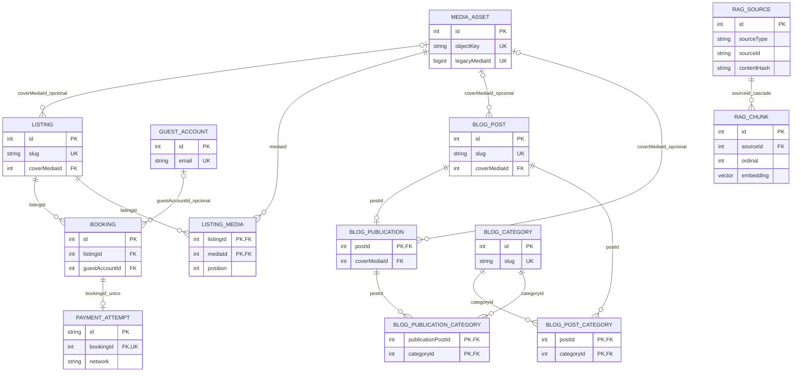
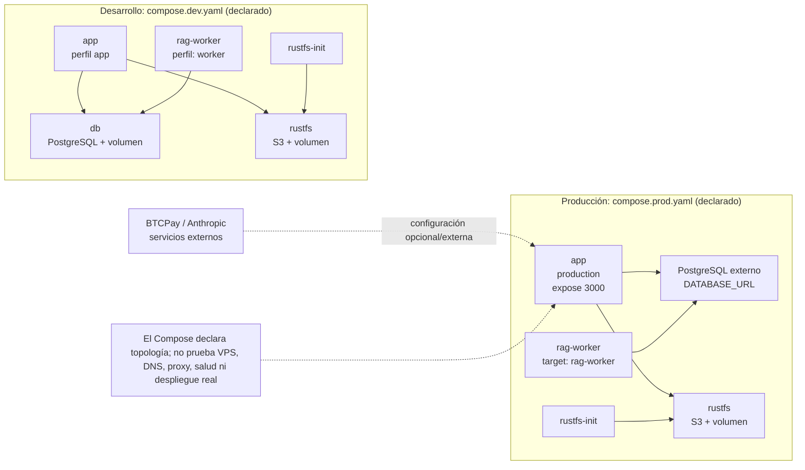

# Datos y operación

[← Índice de arquitectura](./README.md) · [Flujos](./flujos.md) ·
[README técnico](../../README.md)

Este documento describe el estado que puede verificarse en el código y en los
Compose del repositorio. No sustituye los procedimientos de [salida a
producción](../produccion.md), [optimización de imágenes](../image-optimization.md)
ni de [respaldo y restauración](../../backups/README.md).
Que un servicio aparezca en un Compose demuestra que está declarado, no que esté
desplegado o accesible en un entorno concreto.

## Fuentes de verdad y límites

| Dominio | Fuente autoritativa | Límite operativo |
| --- | --- | --- |
| Contenido editorial y catálogo | PostgreSQL, según `infrastructure/prisma/contract.prisma` (`BlogPost`, `BlogPublication`, `Listing`, términos y relaciones) | Los posts publicados se leen desde PostgreSQL; un post o listing no se recupera desde un JSON histórico si falla la base. |
| Reservas, cuentas, pagos y referidos | PostgreSQL (`Booking`, `GuestAccount`, `PaymentAttempt`, `AdminUser`, `ReferralAttribution`) | Las restricciones y transiciones persistidas son las del contrato y sus migraciones. No tratar un estado del navegador como fuente de verdad. |
| Metadatos de medios | PostgreSQL (`MediaAsset`) | `objectKey`, tipo, tamaño, dimensiones y texto alternativo se relacionan con el objeto almacenado; una fila no contiene los bytes. |
| Bytes de medios | RustFS mediante la interfaz S3 compatible | El cliente de servidor usa `S3_ENDPOINT`, `S3_REGION`, `S3_BUCKET` y credenciales de aplicación. La política declarada permite operar el bucket de medios; no expone credenciales aquí. |
| JSON y archivos residuales | `data/pages.json`, `data/media.json`, `data/coupons.json` y `public/media/` para páginas, copy, cupones de solo lectura y arte estático | Son snapshots/configuración editorial de solo lectura. `posts.json`, `listings.json`, `terms.json` y sus relaciones migrados ya no están en el árbol activo ni son fallback operacional. El copy del sitio tiene su propio fallback a valores empaquetados; eso no repone datos de PostgreSQL. |
| Índice RAG | PostgreSQL: `RagSource`, `RagChunk` y `RagSourceQueue` | Solo se indexan publicaciones de blog vigentes y listings activos no archivados. La cola y el worker pueden dejar una fuente fuera de búsqueda mientras está pendiente, procesándose o fallida con error. |

La separación de `MediaAsset` y RustFS es deliberada: borrar o restaurar una
fila no equivale a borrar o restaurar sus bytes. Los importadores verifican
hashes, metadatos y correspondencias antes de escribir; no se debe recomponer la
relación por nombre de archivo o por una URL antigua.

## Modelo relacional enfocado

El siguiente subconjunto usa las claves y relaciones declaradas en
`contract.prisma`; no pretende representar todo el esquema.

Detalles importantes del contrato:

- `Listing.coverMediaId`, las dos portadas del blog y `Booking.guestAccountId`
  son opcionales. Las referencias de reserva a `Listing`, `GuestAccount` y
  `PaymentAttempt` usan `Restrict`; una publicación se elimina en cascada con
  su `BlogPost`, y los chunks se eliminan en cascada con su `RagSource`.
- `ListingMedia`, `BlogPostCategory` y `BlogPublicationCategory` tienen claves
  compuestas. La galería no duplica un `MediaAsset`; guarda la asociación, el
  orden y el contexto.
- `RagSourceQueue` usa la clave compuesta `(sourceType, sourceId)`, pero el
  contrato no declara una FK hacia `RagSource`: coordina por esa clave natural.
  No debe documentarse como una relación referencial de PostgreSQL.

## RAG: índice, cola y pgvector

Las migraciones `20261108T0427_rag_initial_index` y
`20261108T0508_rag_source_queue_contract` crean el índice y la cola de fuentes.
La migración separada de la extensión declara `pgvector`; `vector.sql` instala
`vector` y `verify-vector.sql` comprueba la extensión y una operación de
distancia. La existencia de esos archivos no demuestra que la extensión esté
instalada en una base de destino.

`RagSource` conserva URL canónica, hash, versión del extractor, modelo, revisión
y dimensiones del embedding; `RagChunk` conserva texto, hash, conteo de tokens y
`pgvector.Vector(768)`. El embedding local fijado por código es
`onnx-community/embeddinggemma-2-ONNX`, revisión
`daa72c51243991dfcaf9f9137d2c573d8f7790c0`, en vectores normalizados de 768
dimensiones. La extracción, el encolado, los leases y reintentos, la búsqueda y
la respuesta están descritos sin duplicación en [flujos de RAG](./flujos.md#rag-extracción-cola-búsqueda-y-respuesta).

Los comandos declarados son `pnpm rag:reconcile` y `pnpm rag:worker`. El primero
es de lectura por defecto: solo `--enqueue` habilita la escritura de la cola.
El segundo procesa y escribe el índice; no debe ejecutarse contra una base no
identificada.

## Topología declarada de desarrollo y producción

### Desarrollo

- `app` y `rag-worker` son perfiles separados. La app espera a `db`, RustFS
  saludable y `rustfs-init` completado; el worker espera a PostgreSQL.
- PostgreSQL y RustFS publican sus puertos solo en loopback del host y persisten
  en `postgres_data` y `rustfs_data`. La app usa internamente
  `http://rustfs:9000`; `database-url.mjs` sustituye un host local por
  `DATABASE_COMPOSE_HOST` y el puerto interno de PostgreSQL cuando Compose lo
  necesita.
- `rustfs-init` crea el bucket configurado si no existe. Las claves root de
  RustFS son del servicio/operador; la app usa credenciales S3 de aplicación.

### Producción declarada

- `app` no publica el puerto 3000 al host: solo lo expone para el mecanismo de
  red que se configure fuera de este Compose. `DATABASE_URL` apunta a una base
  externa; no se configura una redirección de `localhost` para producción.
- RustFS y `rustfs-init` sí están declarados, con volumen persistente y puertos
  de host ligados a loopback. El endpoint interno de la app sigue siendo
  `http://rustfs:9000` en el archivo, sujeto a confirmar el destino real.
- `rag-worker` recibe `DATABASE_URL` y se reinicia ante fallo; el Compose no
  ejecuta migraciones automáticamente. No hay evidencia en el repositorio de
  un proxy, DNS, TLS, base externa, bucket o worker de un VPS concreto.

La guía de producción mantiene estos puntos como preparación pendiente. No
reutilizar una base, bucket o volumen existente sin identificar el destino,
respaldo, autorización y ensayo aislado.

## Checks y operaciones con guardas

Estos comandos son referencias al comportamiento implementado, no una orden para
ejecutarlos sobre un destino activo:

| Propósito | Comando/entrada | Guardas verificadas |
| --- | --- | --- |
| Comprobar contrato de BD | `pnpm db:check` | Es un script de verificación del contrato; no equivale a aplicar migraciones ni prueba que el destino sea el correcto. |
| Reconciliar RAG sin escribir | `pnpm rag:reconcile` | Sin `--enqueue` mantiene `write: false`; requiere aun así una `DATABASE_URL` identificada para leer. |
| Preflight del blog | `pnpm blog:dry-run <source-root>` | Solo analiza una fuente explícita; devuelve error si hay bloqueadores y no aplica cambios. |
| Importar catálogo | `pnpm listings:import <source-root>` | El modo por defecto es `dry-run`; `--verify` comprueba el destino y `--apply` escribe BD/S3. |
| Importar reservas | `pnpm bookings:import --source <file>` | El modo por defecto es `dry-run`; `--apply` y `--verify` son explícitos. No apuntar a una base existente sin procedimiento aprobado. |
| Crear o recuperar admin | `pnpm admin:user bootstrap` o `pnpm admin:user recover` | Exige TTY, confirmación textual y contraseña interactiva; `bootstrap` solo funciona con la tabla de usuarios vacía. |
| Respaldo local coordinado ([runbook](../../backups/README.md)) | `node scripts/backup-progress.mjs "nota"` | Solo acepta el Compose local `gateways-dev`, servicios activos y RustFS en loopback; genera el dump y el manifiesto sin restaurar ni reiniciar servicios. |
| Restaurar objetos ([runbook](../../backups/README.md#recuperación)) | `node restore-objects.mjs` dentro del paquete | Sin `--execute` verifica; `--execute` exige bucket vacío y no sobrescribe objetos. La BD se restaura aparte en una base vacía y aislada. |
| Optimizar imágenes existentes ([guía](../image-optimization.md)) | `pnpm images:optimize` o `pnpm images:optimize --apply` | Por defecto es dry-run; solo `--apply` escribe. Revisar el inventario y el informe antes de aplicar. |

`pnpm db:init`, `pnpm db:update`, `pnpm db:migrate`, `pnpm rag:worker` y las
variantes explícitas `--apply`, `--enqueue` o `--execute` (cuando el comando las
admite) son operaciones con efectos. Ejecutarlas solo después de comprobar
identidad del destino, compatibilidad del esquema, respaldo y autorización; no
iniciar una base contra una existente ni aplicar migraciones/importaciones para
descubrir qué hay allí.

## Respaldos, restauración y límites de evidencia

El helper de respaldo conserva un snapshot custom de PostgreSQL y los objetos
del bucket con hashes, metadatos y conciliación con `MediaAsset`. No incluye
objetos fuera del bucket configurado, credenciales, roles globales de
PostgreSQL, políticas/historial del bucket ni archivos fuente sin commit. Los
pasos, exclusiones y el helper de restauración son canónicos en
[backups/README.md](../../backups/README.md); la [guía de producción](../produccion.md#4-datos-y-almacenamiento)
define el destino, la autorización y el ensayo aislado.

El [checkpoint verificado del 2026-11-08](../../backups/README.md) registra
hashes, listado y manifiesto comprobados; su propia nota acota que la
restauración de ese checkpoint no fue ensayada. Esa afirmación histórica no
prueba una recuperación en el destino actual: la configuración de Compose y la
presencia del helper tampoco son una prueba de recuperación operativa.

Para cualquier recuperación se conservan estas guardas: usar una base
PostgreSQL compatible, vacía y aislada y un bucket nuevo, privado y aislado;
verificar marcador, datos, referencias y objetos; nunca restaurar sobre una
base o bucket activo sin respaldo adicional y aprobación explícita.

Finalmente, la evidencia disponible permite afirmar lo siguiente:

- Los nombres de servicios, imágenes fijadas, perfiles, dependencias, puertos,
  volúmenes y variables requeridas son los declarados en los dos Compose; no
  prueban ejecución ni disponibilidad de producción.
- PostgreSQL, RustFS, pgvector, Anthropic y BTCPay requieren configuración o
  conectividad del entorno. BTCPay es externo a estos Compose. El cargo de
  prueba Testnet documentado para la demo no es el total real de la estancia:
  `Booking.totalAmountCents` y los campos de prueba de `PaymentAttempt` se
  almacenan por separado, y el contrato solo permite `network = 'testnet'`.
- No se documentan valores de secretos, credenciales ni URLs privadas. La guía
  de producción sigue siendo la autoridad para comprobar el destino, el proxy,
  HTTPS, permisos mínimos y la aceptación del despliegue.

### Evidencia técnica

- [`infrastructure/prisma/contract.prisma`](../../infrastructure/prisma/contract.prisma)
  y las migraciones RAG del directorio `infrastructure/prisma/migrations/`.
- [`compose.dev.yaml`](../../compose.dev.yaml),
  [`compose.prod.yaml`](../../compose.prod.yaml) y
  [`package.json`](../../package.json).
- [`database-url.mjs`](../../infrastructure/prisma/database-url.mjs),
  [`s3.ts`](../../infrastructure/storage/s3.ts),
  [`vector.sql`](../../infrastructure/postgres/vector.sql) y
  [`verify-vector.sql`](../../infrastructure/postgres/verify-vector.sql).
- [`rag-initial-index.mts`](../../scripts/rag-initial-index.mts),
  [`rag-queue-worker.mts`](../../scripts/rag-queue-worker.mts),
  [`initial-indexer.ts`](../../modules/rag/initial-indexer.ts),
  [`queue-worker.ts`](../../modules/rag/queue-worker.ts) y
  [`search.ts`](../../modules/rag/search.ts).
- [`datos estáticos residuales`](../../data/README.md), [`produccion.md`](../produccion.md)
  y [`image-optimization.md`](../image-optimization.md), usados aquí para
  delimitar el estado operativo y enlazar los procedimientos existentes.
