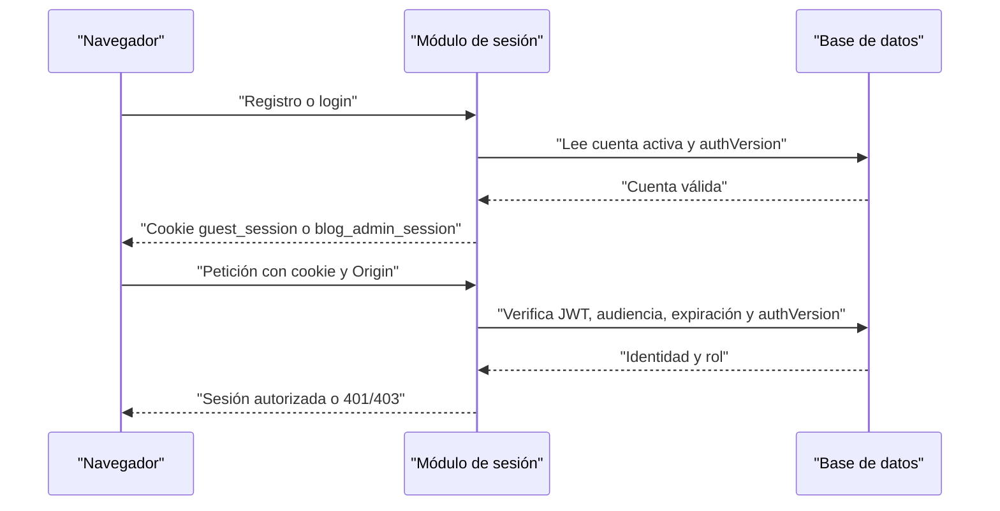
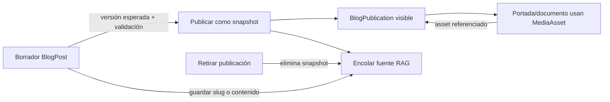
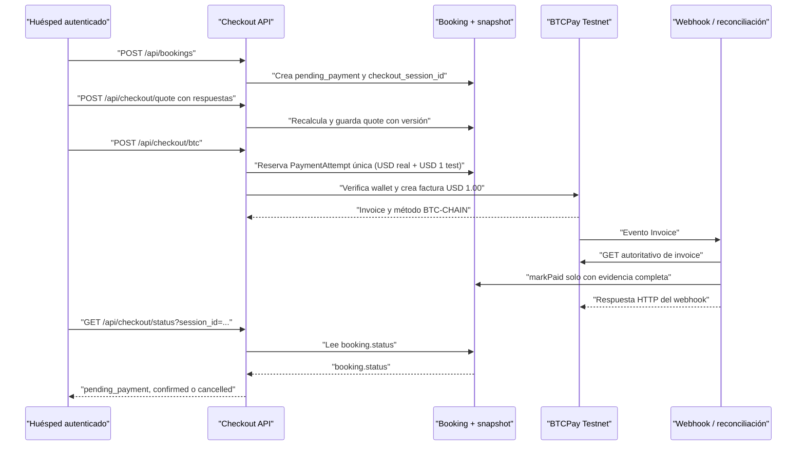
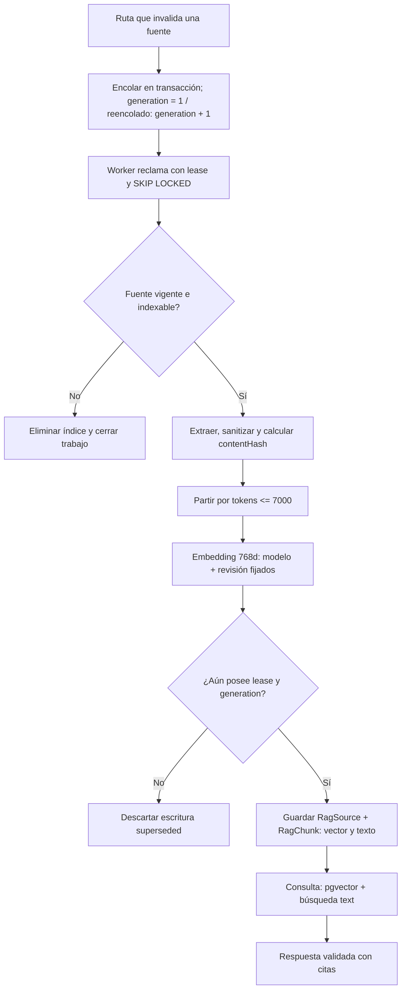

# Flujos de aplicación

[Índice de arquitectura](./README.md) · [Datos y operación](./datos-y-operacion.md) · [README de src](../../README.md)

Este documento describe los flujos implementados actualmente. El código y el
contrato de datos son la fuente de verdad; los estados que aparecen aquí no
implican que todas las transiciones del enum sean válidas.

## Sesiones y autorización

Hay dos sesiones independientes:

- **Huésped**: el registro usa bcrypt y el limitador de intentos; el acceso usa
  bcrypt, pero no está limitado por ese limitador. La sesión se emite en la
  cookie `guest_session` después de validar la cuenta activa
  ([`accounts.ts`](../../modules/guests/server/accounts.ts)).
- **Personal**: el acceso usa la cuenta `AdminUser` activa y emite
  `blog_admin_session` ([`login.ts`](../../modules/auth/server/login.ts)). Sus
  roles son `ADMIN`, `EDITOR` y `BOOKING_MANAGER`
  ([`auth.ts`](../../modules/auth/server/auth.ts)).

Ambas sesiones son JWT HS256 con emisor `gateways`, una audiencia específica,
`iat`/`exp` y una duración de ocho horas. El claim `sv` debe coincidir con
`authVersion` de la cuenta; desactivar la cuenta, cambiar su versión o revocar
la sesión invalida el token. Las cookies son `HttpOnly` y `SameSite=Strict`; en
HTTPS también llevan `Secure`. Las mutaciones comprueban además el origen
configurado.

La autorización se vuelve a comprobar dentro de la transacción antes de
escribir: el blog permite a `ADMIN` y `EDITOR` editar, pero publicar y retirar
publicaciones requiere `ADMIN` ([`blog-auth.ts`](../../modules/content/server/blog-auth.ts)).
En el catálogo, `ADMIN` y `EDITOR` pueden editar contenido descriptivo; los
precios, la capacidad, las políticas y el ciclo de vida requieren `ADMIN`
([`listing-admin.ts`](../../modules/listings/server/listing-admin.ts)). Las
reservas nuevas pertenecen a la cuenta de huésped autenticada; el servidor
copia de ella nombre, correo y teléfono, no los acepta del navegador
([`route.ts`](../../app/api/bookings/route.ts)).

## Catálogo, blog y media

El catálogo público solo proyecta listings `active = true` y sin `archivedAt`;
incluye atributos comerciales, categorías y media asociada
([`catalog.ts`](../../modules/listings/server/catalog.ts)). Una edición de
listing bloquea la fila, exige la versión esperada y vuelve a encolar su fuente
RAG. Los bookings ya creados conservan su `pricingSnapshot`; una edición
posterior del catálogo no los reprecifica.

El blog separa el borrador (`BlogPost`) de la publicación (`BlogPublication`):

1. El personal autorizado crea o guarda el borrador. Se validan slug, documento,
   categorías y referencias a `MediaAsset`; la versión esperada evita que una
   edición sobrescriba otra. Tras la primera publicación, el slug no puede
   cambiar ([`blog-operations.ts`](../../modules/content/server/blog-operations.ts)).
2. `ADMIN` publica solo si hay título, texto o imagen y, si hay portada, texto
   alternativo. La publicación es un snapshot del documento y sus categorías.
   El acceso público busca esa publicación, no el borrador
   ([`content.ts`](../../modules/content/server/content.ts),
   [`content-postgres.ts`](../../modules/content/server/content-postgres.ts)).
3. Retirar una publicación elimina `BlogPublication` y vuelve a encolar la
   fuente. La ruta revalida el índice y la ruta del artículo
   ([`publish/route.ts`](../../app/api/blog/admin/posts/[id]/publish/route.ts),
   [`unpublish/route.ts`](../../app/api/blog/admin/posts/[id]/unpublish/route.ts)).

La media pasa por un flujo separado: la subida exige sesión de blog, origen
válido, `image/jpeg`, `image/png` o `image/webp`, y un máximo de 10 MiB; se
optimiza antes de guardarse en S3 y después se registra en la base de datos. Si
ese registro falla, se intenta borrar el objeto para compensar la escritura
externa ([`media/route.ts`](../../app/api/blog/media/route.ts)). Una referencia
de portada, galería o documento debe apuntar a un asset existente. La lectura
de media es pública solo cuando el asset está referenciado por una publicación
o por un listing activo; en otro caso exige autorización de blog
([`media/[id]/route.ts`](../../app/api/blog/media/[id]/route.ts)).

## Reserva, cotización y pago

### Reserva y cotización

`POST /api/bookings` exige cuenta de huésped y mismo origen. Comprueba fechas,
capacidad, listing activo y reglas de estancia; consulta las reservas
confirmadas usando intervalos semiabiertos `[check_in, check_out)`. La escritura
bloquea el listing y vuelve a comprobar los conflictos en la misma transacción.
La reserva se crea como `pending_payment`, con moneda `USD`, título acordado y
snapshot de precio/capacidad/impuestos. Luego se asocia un checkout session ID
canónico mediante una actualización condicionada por versión
([`route.ts`](../../app/api/bookings/route.ts),
[`bookings.ts`](../../modules/bookings/server/bookings.ts),
[`booking-store.ts`](../../modules/bookings/server/booking-store.ts)).

`POST /api/checkout/quote` recibe las respuestas de huéspedes y mascotas, no un
total confiable del cliente. Recalcula en el servidor con importes enteros en
centavos: estancia, limpieza, huésped adicional, mascota, descuento e IVA más
impuesto turístico. El descuento se limita al subtotal y la limpieza queda
fuera de la base imponible ([`booking-quote.ts`](../../modules/bookings/booking-quote.ts)).
La cotización se guarda con la versión esperada. Si ya existe
`payment_reference`, hay una revisión de precio pendiente o cambió la fila,
responde conflicto; una tentativa de pago abierta congela el importe
([`quote/route.ts`](../../app/api/checkout/quote/route.ts)).

### Attempt BTCPay Testnet

La ruta de Bitcoin solo se habilita cuando el proveedor está configurado como
`btcpay-testnet`, la red es `testnet` y están presentes las verificaciones de
wallet esperadas. Antes de llamar a BTCPay, `reservePaymentAttempt` bloquea el
listing y la reserva, comprueba versión, estado, snapshot y total real, y crea
una sola tentativa por booking. La tentativa conserva:

- `realTotalCents`: el importe real de la estancia;
- `testAmountCents = 100`: un cargo independiente de **USD 1.00** en testnet;
- `network = testnet`, proveedor, store y `paymentReference` estable.

El proveedor verifica BTCPay 2.4.7, sincronización completa, método
`BTC-CHAIN`, wallet esperada y dirección testnet. La factura usa USD 1.00,
tolerancia cero, expiración de 15 minutos y monitorización de 1440 minutos.
Las llamadas HTTP tienen timeout de 12 segundos. Una reserva duradera no se
reemplaza automáticamente después de un timeout: la tentativa queda para
reconciliación y no se abre otra factura ([`btcpay-testnet.ts`](../../modules/payments/btcpay-testnet.ts),
[`payment-attempts.ts`](../../modules/payments/server/payment-attempts.ts),
[`types.ts`](../../modules/payments/types.ts)).

### Reconciliación, confirmación y conflictos tardíos

El webhook primero limita el cuerpo a 64 KiB y valida la firma HMAC
`BTCPay-Sig`. El tipo y el orden del evento son solo una señal: se vuelve a
consultar la factura. La evidencia se acepta como `paid` únicamente si coincide
la tentativa, store, `orderId`, USD 1.00, red testnet, método BTC-CHAIN, destino,
importe liquidado y saldo pendiente cero. Una factura `New` o `Processing` sin
evidencia incompatible permanece pendiente; un pago parcial, inválido o
inconsistente, una factura `Expired` o `Invalid`, o un estado adicional distinto
 de `None` pasa a `review`. Solo una factura `Settled` con la evidencia completa
 exigida se acepta como pagada y acredita la reserva. En revisión o error se ocultan
 las instrucciones de pago; en el flujo normal pendiente, `GET /api/checkout/btc`
 puede devolver la dirección y el enlace para continuar
 ([implementación BTCPay Testnet](../../modules/payments/btcpay-testnet.ts),
 [`webhooks/btcpay/route.ts`](../../app/api/webhooks/btcpay/route.ts)).

`markPaid` vuelve a bloquear el listing y la reserva y exige coincidencia exacta
de `paymentId`, booking, importe y moneda. Si la reserva sigue pendiente y no
se solapa con una confirmada, pasa a `confirmed`. Si llega un pago después de
una cancelación o cuando las fechas ya chocan, pasa o permanece en `cancelled`,
marca `paymentReviewRequired` y deja una nota de revisión/reembolso manual. Un
webhook repetido sobre una reserva confirmada no vuelve a cambiarla. La
cancelación de una confirmada por personal también requiere revisión financiera;
no emite un reembolso automático ([`booking-store.ts`](../../modules/bookings/server/booking-store.ts)).

```mermaid
stateDiagram-v2
    [*] --> pending_payment: "reserva creada con snapshot"
    pending_payment --> confirmed: "markPaid + evidencia exacta + sin solapamiento"
    pending_payment --> cancelled: "cancelación autorizada"
    pending_payment --> cancelled: "pago tardío con solapamiento; revisión"
    confirmed --> cancelled: "cancelación de personal; revisión financiera"
    confirmed --> confirmed: "webhook repetido; sin cambio"
    cancelled --> cancelled: "pago posterior; revisión/reembolso manual"
    confirmed --> [*]
    cancelled --> [*]
```

El webhook responde a BTCPay después de la reconciliación. La página de checkout
consulta `GET /api/checkout/status?session_id=...`, que devuelve el estado de la
reserva: `pending_payment`, `confirmed` o `cancelled`. La revisión del pago no es
un estado de la reserva ni se expone en esta ruta. El pago persistido seguro, cuando
aplica, se consulta por `/api/checkout/btc`, no por `/api/checkout/status`. La
reconciliación del checkout devuelve instrucciones únicamente cuando la evidencia
del proveedor es válida; en error, conflicto o revisión las oculta
([`status/route.ts`](../../app/api/checkout/status/route.ts),
[`btc/route.ts`](../../app/api/checkout/btc/route.ts)).

## RAG: extracción, cola, búsqueda y respuesta

Las rutas administrativas que efectivamente invalidan una fuente indexable
—cambios de listing, publicación/despublicación o cambio de slug de blog, y
cambios de categorías afectadas— encolan la fuente en la misma transacción que
el cambio de origen. El indexador/reconciliador vuelve a encolar las fuentes que
detecta fuera de sincronía. La clave `(sourceType, sourceId)` es única; la
primera inserción usa `generation = 1` y cada reencolado posterior incrementa
`generation`, reinicia el backoff y deja el trabajo `pending`
([`rag-source-queue.ts`](../../infrastructure/prisma/rag-source-queue.ts),
[`blog-operations.ts`](../../modules/content/server/blog-operations.ts),
[`listing-admin.ts`](../../modules/listings/server/listing-admin.ts),
[`category-admin.ts`](../../modules/categories/server/category-admin.ts),
[`initial-indexer.ts`](../../modules/rag/initial-indexer.ts)).

El worker reclama un trabajo con `SKIP LOCKED`, lease de cinco minutos y máximo
de ocho intentos. Un fallo usa backoff exponencial hasta una hora; al superar
el límite queda `failed`. La extracción solo acepta publicaciones vigentes y
listings activos no archivados. Sanitiza HTML o recorre el documento de blog,
normaliza secciones y calcula `contentHash`; después divide por tokens, con
límite de 7000 por chunk, y genera vectores de 768 dimensiones. La transacción
final comprueba que aún posee el `leaseToken` y la `generation` antes de
reemplazar `RagChunk`; una fuente ya no indexable elimina su índice
([`initial-index.ts`](../../modules/rag/initial-index.ts),
[`queue-worker.ts`](../../modules/rag/queue-worker.ts),
[`embedding.ts`](../../ai/embedding.ts)).

El esquema y los metadatos de `RagSource`, `RagChunk` y `RagSourceQueue`, incluido
el vector pgvector, están documentados en [Datos y operación](./datos-y-operacion.md#rag-índice-cola-y-pgvector).

`POST /api/rag/answer` requiere cuenta de huésped, mismo origen y limitación
por cuenta. El cuerpo tiene un máximo de 12,000 bytes; la pregunta admite hasta 1000
caracteres, el historial seis mensajes de hasta 1200 caracteres y el total
pregunta/historial 4000. El agente permite dos generaciones concurrentes,
recupera como máximo seis fuentes y tres tarjetas, limita el contexto a 9000
caracteres y la respuesta a 4000 ([`answer/route.ts`](../../app/api/rag/answer/route.ts),
[`agent.ts`](../../modules/rag/agent.ts)).

El agente extrae solo restricciones positivas y el buscador las valida: los
filtros desconocidos, capacidades fuera de rango, categorías inexistentes y
amenidades no reconocidas fallan cerrados. La búsqueda combina similitud
vectorial (0.65) y texto PostgreSQL (0.35), y excluye fuentes pendientes, en
procesamiento o fallidas con error. También exige que el blog siga publicado y
que el listing siga activo y no archivado ([`search.ts`](../../modules/rag/search.ts)).

El modelo recibe fuentes como datos no confiables, sin datos personales básicos,
y no puede crear reservas, pagos, precios ni disponibilidad. Solo puede citar
IDs recuperados. Las URLs se reducen a rutas canónicas locales; antes de
responder se repite la búsqueda y se comparan hash, URL, título e imagen. Si la
fuente cambió, desapareció, se despublicó o dejó de cumplir filtros, la
respuesta falla cerrada en vez de producir citas obsoletas
([`agent.ts`](../../modules/rag/agent.ts)).

## Evidencia principal

- [Sesión de personal](../../modules/auth/server/auth.ts) y [sesión de huésped](../../modules/guests/server/auth.ts).
- [Reserva y validaciones](../../modules/bookings/server/bookings.ts) y [persistencia/transiciones](../../modules/bookings/server/booking-store.ts).
- [Proveedor BTCPay Testnet](../../modules/payments/btcpay-testnet.ts) y [tentativas](../../modules/payments/server/payment-attempts.ts).
- [Publicación editorial](../../modules/content/server/blog-operations.ts) y [lectura pública](../../modules/content/server/content-postgres.ts).
- [Worker RAG](../../modules/rag/queue-worker.ts), [búsqueda](../../modules/rag/search.ts) y [respuesta](../../app/api/rag/answer/route.ts).

## Navegación relacionada

- [Producción](../produccion.md)
- [Respaldos y restauración](../../backups/README.md)
- [Optimización de imágenes](../image-optimization.md)
